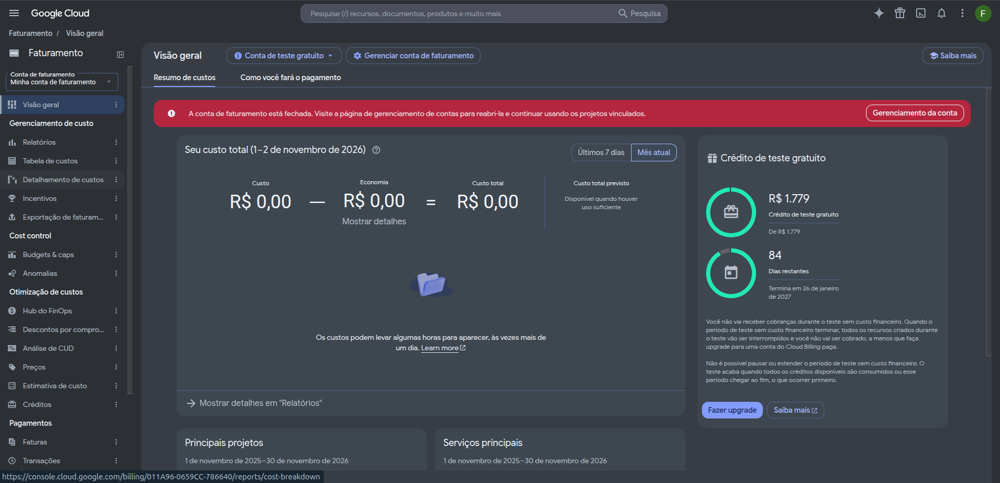

# FinOps — Pegada Rede em custo zero

> **Este documento substitui a versão anterior.** O orçamento de R$ 280 com
> alertas 50/80/100% foi **removido do escopo**: o *Plano Custo Zero — sem o
> voucher do GCP* (Pedro Henrique Pereira Santos, 14/10/2026) proíbe conta de
> faturamento e cartão. A prova exigida passou a ser o oposto: print mostrando
> plano gratuito e **nenhuma forma de pagamento**.

## Regra que vale para este projeto

O Pegada Rede é o caso mais simples do plano: nenhuma peça extra além da base
comum. Nenhum serviço do projeto exige cartão, e a arquitetura foi escolhida
para que **não exista caminho técnico para uma cobrança**.

| Regra do Plano Custo Zero | Como o Pegada Rede cumpre |
| --- | --- |
| 1. Nunca cadastrar cartão | Nenhum serviço usado pede cartão: Firebase Spark, Render free, GitHub público |
| 2. Nunca clicar em Upgrade/Blaze | Projeto Firebase criado direto no Spark |
| 3. Teste pesado só no emulador | Os 182 testes do backend e os 43 do frontend rodam no Compose |
| 4. Um projeto Firebase por equipe | `demo-carbontrace` no emulador; projeto Spark na Semana 5 |
| 5. Chave com permissão mínima | Sem chave hoje; entra na Semana 5 em variável protegida |
| 6. Print de plano gratuito em /docs/finops | Tabela de evidências abaixo |

## Estado do faturamento — encerrado

O projeto `project-980790f0-5546-4522-b57` e a conta de faturamento
`011A96-0659CC-786640` **foram encerrados em 02/11/2026**, antes do deploy de
qualquer serviço. Não há projeto ativo, não há orçamento ativo e não há forma
de pagamento associada a nada do CarbonTrace.

O print mostra, na própria linha da conta:

- **Status:** `Encerrada em` — a conta não pode receber cobrança;
- **Gastos dos últimos 30 dias:** `R$ 0`;
- **Tipo:** `Direta`.

Conta encerrada não é reativada por acidente: exigiria criar outra e vincular
um projeto novo, com decisão explícita.

## Arquitetura de custo zero

| Peça do Caderno | Substituto | Limite do plano gratuito | Custo |
| --- | --- | --- | --- |
| Firebase Hosting (frontend) | igual — plano Spark | 10 GB e 360 MB/dia | R$ 0 |
| Firebase Auth | igual — plano Spark | 50 mil usuários ativos/mês | R$ 0 |
| Firestore | igual — plano Spark | 1 GiB; 50 mil leituras, 20 mil escritas e 20 mil exclusões/dia | R$ 0 |
| Cloud Run (API) | Render, web service free | 750 h/mês; dorme após 15 min | R$ 0 |
| Cloud Scheduler | GitHub Actions (`schedule`) | ilimitado em repositório público | R$ 0 |
| Secret Manager | variáveis do Render + GitHub Secrets | — | R$ 0 |
| Workload Identity | chave de serviço em variável protegida | — | R$ 0 |
| Cloud Logging/Monitoring | logs do Render + UptimeRobot | 50 monitores, checagem a cada 5 min | R$ 0 |
| Alertas de orçamento | **não se aplica** (sem faturamento) | — | R$ 0 |

**Gasto acumulado no CP2: US$ 0.** No CP2 nada roda fora do computador: o
ambiente inteiro é Compose com Auth e Firestore Emulator, e o projeto usado por
todos os arquivos é `demo-carbontrace`, identificador fictício que o prefixo
`demo-` mantém offline.

## Exceções ao Caderno — exigem ADR e aprovação do professor

Três das seis exceções listadas no plano se aplicam ao Pegada Rede:

1. **API fora do Cloud Run**, no Render;
2. **CORS restrito ao domínio da equipe**, no lugar do rewrite de mesma origem do Hosting;
3. **Chave de serviço** em variável protegida, no lugar do Workload Identity.

As outras três (Supabase Storage, GitHub Actions como agendador, UptimeRobot)
só valem para Habilita, LicitaRadar e EntregaProva.

## Evidências a coletar

| Serviço | O que o print precisa mostrar | Situação |
| --- | --- | --- |
| Google Cloud — conta de faturamento | status **Encerrada**, gastos R$ 0 | **coletado em 02/11** |
| Firebase Console | selo **Spark**, nenhum "Blaze" | pendente — projeto será criado na Semana 5 |
| Render | instância **Free**, sem cartão | pendente — Semana 5 |
| GitHub Actions | repositório público | disponível desde já |

Os dois pendentes só existem a partir da Semana 5, quando o deploy acontece.
Não bloqueiam o CP2, que é local por definição.

## Cuidados de cota (Semana 5 em diante)

O plano Spark não cobra: quando um limite diário estoura, o serviço para até o
dia seguinte. O risco é de **indisponibilidade na demo**, não de custo.

- **Firestore — 50 mil leituras/dia.** O dashboard lê totais prontos, nunca a
  coleção inteira; as listas usam paginação por cursor.
- **Firestore — 20 mil escritas/dia.** Nada de seed grande na produção. Seed é
  coisa de emulador.
- **Render — 750 h/mês.** Um único serviço por workspace. Ligado o mês inteiro
  consome cerca de 744 h: não cabe um segundo serviço.
- **Render dorme em 15 min.** A primeira requisição depois disso leva cerca de
  1 minuto. Na demo, acordar a API 5 minutos antes e manter a tela de
  carregamento.

## Histórico

| Data | Fato |
| --- | --- |
| 14/10/2026 | Plano Custo Zero publicado pelo tutor; alertas de orçamento substituídos por print de plano gratuito |
| 28/10/2026 | Orçamento de R$ 280 e estimativa de US$ 0,36 produzidos — **descartados** pela virada |
| 02/11/2026 | Projeto `project-980790f0` e conta de faturamento `011A96` encerrados; evidência coletada |
